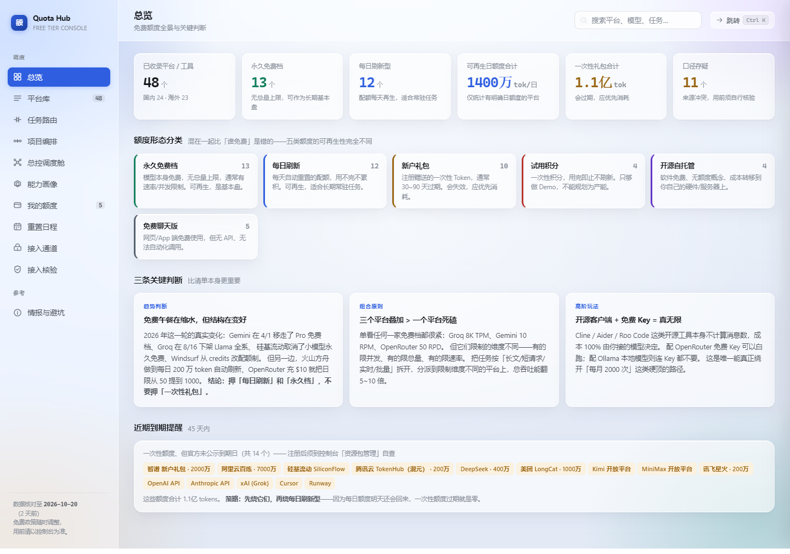

# AI Agent 免费额度调度中台

把各家大模型的「免费额度」真正用起来的调度台：额度盘点、跨模型分阶段编排、总控一致性闭环、接入通道与网关配置、主流模型接入核验。

单文件 HTML 应用（无构建依赖、无后端、双击即用），毛玻璃界面，`Ctrl + K` 可全局跳转，配套一份 11 章的调研报告。



## 在线访问

**https://albertlionzz.github.io/ai-agent-quota-hub/**

每次 push 到 `main`，GitHub Actions 会自动把构建产物发布到这个地址（见 `.github/workflows/pages.yml`）。想离线用，直接下载仓库里的 `AI-Agent免费额度调度中台.html` 双击打开——不联网也能跑。

> **首次开启**：Pages 站点需要管理员在仓库 Settings → Pages → Build and deployment → Source 选「GitHub Actions」并保存一次。`GITHUB_TOKEN` 建不了站点（该接口要 admin 权限），所以工作流只能检测不能代劳；未开启时它会给出警告并跳过发布，不会报红。

## 它解决什么问题

拿到一堆免费额度之后，真正会卡住的不是「哪家送得多」，而是这三件事：

1. **额度混在一起比** —— 一次性礼包、每日刷新、试用金、网页版额度、自托管，五种形态混着算，结论一定是错的。
2. **接不通** —— 端点域名、路径版本、model id 三处任一处过时，脚本第一次就跑不起来。
3. **跑不完一个项目** —— 单个模型的免费额度撑不住完整项目，需要按阶段换模型，并把上下文压缩成「交接卡」往下传。

中台对应给出：五类额度建模 → 项目编排流水线 → 总控调度舱 → 接入通道与网关 → 23 家接入核验。

## 11 个视图

| 视图 | 作用 |
|---|---|
| 总览 | 额度总盘、可持续产能、红线提示 |
| 平台库 | 48 个平台的额度、限制维度（RPD / TPM / 并发）、注册门槛 |
| 任务路由 | 按任务需求把额度分配出去，算缺口 |
| 项目编排 | 6 个模板 × 2 种执行模式，多模型分阶段跑完一个项目 |
| 总控调度舱 | 四角色（总控 / 执行 / 审查 / 汇总）+ 状态卡 + 五类冲突检查 + 经验库 |
| 能力画像 | 12 模型 × 9 维得分，每条挂评测来源与可信度分级 |
| 我的额度 | 已开通清单、用量登记（算得出真实余量）、JSON 备份导出/导入 |
| 重置日程 | 今天哪些额度会刷新、哪些只减不增、哪些周期未公示 |
| 接入通道 | 三类额度、五条接入路径、LiteLLM 网关配置生成 |
| 接入核验 | 23 家主流厂商的端点 / 环境变量 / model id / 退役清单 / 免费状态，附自检脚本导出 |
| 情报与避坑 | 已终止的通道、数据存疑项 |

## 快速开始

直接打开 `AI-Agent免费额度调度中台.html`（单文件，含全部样式与脚本，离线可用）。

从源码构建：

```bash
cd quota-hub
python build.py          # 产出 ../AI-Agent免费额度调度中台.html
```

`build.py` 把 `assets/*.js` 按固定顺序注入 `app.js` 的 IIFE 内部（USAGE → WALLETIO → SCHEDULE → CAP → PIPE → ORCH → ACCESS → VERIFY → PALETTE），再套进 `template.html`。顺序有依赖：orchestrator 用 pipeline 的产能函数，access 与 verify 用 pipeline 的端点表。

## 测试

```bash
cd quota-hub
node test-route.js       # 路由分配不变量
node test-pipeline.js    # 编排：模板 × 规模 × 模式全组合
node test-export.js      # 导出脚本语法与要素
node test-orch.js        # 总控 121 项断言
node test-access.js      # 网关配置：真实 YAML 解析 + Python 编译（32 项）
node test-verify.js      # 接入核验 28 项：含「核验表 base 与端点表逐字一致」
node test-usage.js       # 用量登记纯函数 40 项（解析 1.5万/200k、跨天归零、超额夹取）
node test-palette.js     # 全局跳转 14 项：含「kimi 不能拖出 DeepSeek」假阳性回归
node test-walletio.js    # 备份导入 22 项：坏输入全拒、脏字段清洗、合并语义
node test-schedule.js    # 重置日程 20 项：分桶、不编造日期、0 点倒计时边界
```

`test-verify.js` 里最有用的一条断言：核验表里的 `base_url` 必须与端点表 `PIPE_BASE` 完全一致 —— 防止只改一处。

`test-usage.js` 直接 `require` 真实的 `assets/usage.js`，而不是把逻辑抄一份 —— 抄一份的测试，代码改了它不会红。

## 目录结构

```
AI-Agent免费额度调度中台.html   构建产物（单文件）
AI-Agent免费额度调研报告.md      11 章调研报告
.github/workflows/pages.yml     push 后自动发布到 GitHub Pages
docs/screenshot-overview.png    README 用的界面截图
quota-hub/
  build.py                 注入式构建
  test-*.js                6 个测试文件
  assets/
    data.js                48 个平台的额度数据
    app.js                 主逻辑与视图框架
    template.html          页面骨架
    style.css              样式
    pipeline.js            项目编排（交接卡 / 产能 / 导出）
    capability.js          12 模型 × 9 维能力画像
    orchestrator.js        总控调度舱
    access.js              接入通道与网关配置
    verify.js              接入核验（23 家）
    usage.js               用量登记纯函数（解析 / 余量 / 跨天归零）
    walletio.js            备份导出/导入与校验
    schedule.js            重置日程分桶
    palette.js             Ctrl+K 全局跳转
```

## 关于数据准确性

- 额度与接入字段全部对着**官方文档**核对，每个条目都记录核实日期与出处链接。
- 存在互相冲突的二手说法时，标为「口径冲突 / 免费存疑」，而不是二选一硬写 —— 这类必须去控制台确认。
- 数据截至 **2026-10-20**（接入字段复核于 2026-10-21）。免费政策变动频繁，超过 1 个月请重新核实。
- 需要跑一遍才算数的，用「接入核验」页导出的 `verify_all.py`：默认 `GET /models`，不消耗 token 与请求次数。

## License

MIT
