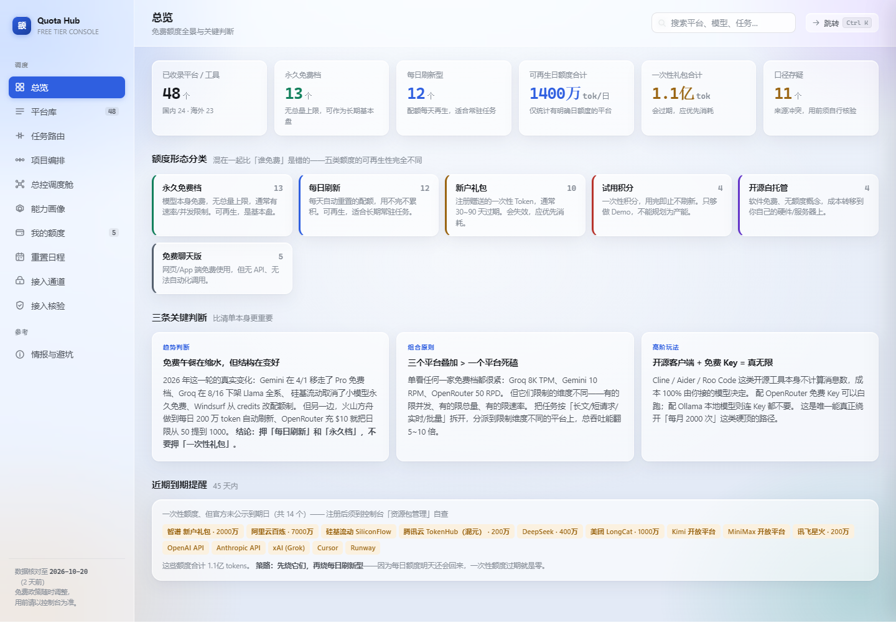

# AI Agent 免费额度调度中台

把各家大模型的「免费额度」真正用起来的调度台：额度盘点、跨模型分阶段编排、总控一致性闭环、接入通道与网关配置、主流模型接入核验。

单文件 HTML 应用（无构建依赖、无后端、双击即用），毛玻璃界面，`Ctrl + K` 可全局跳转，配套一份 11 章的调研报告。
接入核验页带**自动探活**：GitHub Actions 每 6 小时探测 24 家端点是否还通，结果写进 `probe.json` 并内联进页面——所以数据有一个可验证的「新鲜度」，而不是一句「核对至某日」。同一趟 CI 还会重建离线产物并跑一遍真实窄屏（320 / 360 / 518 / 768px）横向溢出回归，样式改坏了不会悄悄发布。



## 在线访问

**https://albertlionzz.github.io/ai-agent-quota-hub/**

每次 push 到 `main`，GitHub Actions 会自动把构建产物发布到这个地址（见 `.github/workflows/pages.yml`）。想离线用，直接下载仓库里的 `AI-Agent免费额度调度中台.html` 双击打开——不联网也能跑。

> **首次开启**：Pages 站点需要管理员在仓库 Settings → Pages → Build and deployment → Source 选「GitHub Actions」并保存一次。`GITHUB_TOKEN` 建不了站点（该接口要 admin 权限），所以工作流只能检测不能代劳；未开启时它会给出警告并跳过发布，不会报红。

## 它解决什么问题

拿到一堆免费额度之后，真正会卡住的不是「哪家送得多」，而是这三件事：

1. **额度混在一起比** —— 一次性礼包、每日刷新、试用金、网页版额度、自托管，五种形态混着算，结论一定是错的。
2. **接不通** —— 端点域名、路径版本、model id 三处任一处过时，脚本第一次就跑不起来。
3. **跑不完一个项目** —— 单个模型的免费额度撑不住完整项目，需要按阶段换模型，并把上下文压缩成「交接卡」往下传。

中台对应给出：五类额度建模 → 项目编排流水线 → 总控调度舱 → 接入通道与网关 → 25 家接入核验。

## 12 个视图

| 视图 | 作用 |
|---|---|
| 总览 | 额度总盘、可持续产能、红线提示 |
| 平台库 | 48 个平台的额度、限制维度（RPD / TPM / 并发）、注册门槛；顶部「数据可信度分布」堆叠条可点选筛选 |
| 任务路由 | 按任务需求把额度分配出去，算缺口 |
| 项目编排 | 6 个模板 × 2 种执行模式，多模型分阶段跑完一个项目 |
| 总控调度舱 | 四角色（总控 / 执行 / 审查 / 汇总）+ 状态卡 + 五类冲突检查 + 经验库 |
| 能力画像 | 12 模型 × 9 维得分，每条挂评测来源与可信度分级 |
| 我的额度 | 已开通清单、用量登记（算得出真实余量）、JSON 备份导出/导入、**限流冷却**（429 后按 15 分钟～1 天锁住，排产自动跳过并说明跳过谁） |
| 重置日程 | 今天哪些额度会刷新、哪些只减不增、哪些周期未公示 |
| 接入通道 | 两个问题给一条路（向导）、粘贴 key 生成配置命令、三类额度、五条路径、五家网关对比、三种导出（LiteLLM yaml / runner / 通用 .env） |
| 接入核验 | 25 家主流厂商的端点 / 环境变量 / model id / 退役清单 / 免费状态，附自动探活与自检脚本导出 |
| 交叉校验 | 三源口径并列比对 + 冲突高亮；顶部「数据新鲜度」条列三源核实日期与最近探活；一张 5×3「判定 × 可信度」联合矩阵，点格子同时套两个筛选跳到平台库；点厂商名跳接入核验、核验卡片可跳回；平台库 24 张卡片带轻量角标，可按判定筛选，并附 24 家「为什么不给标记」的分形态说明 |
| 情报与避坑 | 已终止的通道、数据存疑项 |

## 快速开始

直接打开 `AI-Agent免费额度调度中台.html`（单文件，含全部样式与脚本，离线可用）。

从源码构建：

```bash
cd quota-hub
python build.py          # 产出 ../AI-Agent免费额度调度中台.html
```

`build.py` 把 `assets/*.js` 按固定顺序注入 `app.js` 的 IIFE 内部（USAGE → COOLDOWN → SCHEDULE → ONBOARD → WALLETIO → CAP → PIPE → ORCH → ACCESS → PROBESNAP + PROBE → VERIFY → CCSOURCES + CROSSCHECK → PALETTE），再套进 `template.html`。顺序有依赖：orchestrator 用 pipeline 的产能函数，access 与 verify 用 pipeline 的端点表，crosscheck 用来源快照与 verify 的厂商 id。

## 自动探活（probe.json）

接入核验页顶部那张卡片不是手写的，是跑出来的。

```bash
node quota-hub/probe/gen_endpoints.js    # 从 assets/verify.js 抽出端点清单 → probe/endpoints.json
python quota-hub/probe/probe.py          # 逐个探测 → probe.json
```

`.github/workflows/probe.yml` 每 6 小时（`17 */6 * * *`）跑一次并把 `probe.json` 提交回仓库，Pages 和单文件产物都读它。**零 secret 也能跑**，这是设计上有意为之：

| 探测结果 | 含义 | 要做什么 |
|---|---|---|
| `ok` 200 | 带 key 通了 | 无 |
| `auth` 401 | **端点存在**，只是没配 key | 正常，路是对的 |
| `badkey` 401/403 | 带了 key 仍被拒 | 去控制台重新生成 key |
| `forbidden` 403 | 地域封锁 / IP 限制 / 无该模型权限 | 换 key 未必有用，先看原因 |
| `notfound` 404 | base_url 或路径写错 | **这才是真错误**，跟 key 无关 |
| `unreachable` | 网络层到不了（含代理回 502 connect failed） | 看执行环境，不代表平台挂了 |
| `ratelimited` 429 | 配置没问题，额度或频率到了 | 等重置或降并发 |

几个刻意的取舍：

- **测的是「路」，不是「量」**。用 `GET /models`，不消耗 token、不占生成额度，所以它只能证明接得通，证明不了还剩多少——这一页从不假装知道你的余额。
- **401 不报警**。把「没配 key」当成故障，会让这个看板永远一片红，最后没人看。
- **403 和 401 分开**。401 是「没出示证件」，403 是「出示了也不让进」，合并会让人白白去换 key。
- **代理的 502 归到 unreachable**。企业网关连不上上游时常回 502 + `connect failed`，那是网络问题，不是对方服务端挂了。
- **执行环境决定结论，而且两个方向都会失真**。首轮实测：本机（境内网络）有 4 家「未连通」（OpenAI / Gemini / xAI / Mistral），而 GitHub 海外 runner 一家都没断路、17 家回 401——所以「未连通」说的是这台机器到不了，不是平台挂了。页面里把执行环境标出来，就是为了让人知道该信哪一半。

想加 key 让探活变成真验证：仓库 Settings → Secrets and variables → Actions，按 `probe/endpoints.json` 里的 `env` 字段建同名 secret（如 `ZHIPUAI_API_KEY`）。没建的会按「无 key」处理，不会报错。

## 限流冷却

额度表回答的是「这个平台有多少量」，不回答「它此刻肯不肯收你」。真实使用里最常见的状态是 429：余额还在，但这一段时间它就是不接。

「我的额度」每张卡都带一个冷却下拉（15 分钟 / 1 小时 / 6 小时 / 到明天），标了之后：

- 卡片上显示「限流 · 剩 42 分钟」，KPI 汇总里单列「N 个限流中」；
- **任务路由会把它从候选里摘掉**，并在结论下面写清跳过谁、还剩多久——静默少算一个平台比多算更坏，人会以为额度真的不够；
- 到期自动恢复，不用手动解锁；导出的备份里带到期时间，换设备也还在。

它刻意不叫「停用」：停用是人的决定，冷却是平台的决定，混在一起会让人以为是自己关掉的。

## 网关导出：为什么没有 OmniRoute / FreeLLMAPI 的原生配置

本页有五个网关的对比，但只导出 LiteLLM 的 `litellm_config.yaml`（外加一个只认单端点的 runner），以及一份**通用 `.env`**。

原因不是偷懒：OmniRoute 的 provider 是在它自己的 Dashboard 里加的、凭据落在 `.env`（仓库只给 `.env.example`）；FreeLLMAPI 的批量导入入口同样是 `.env`。两家都没有公开、可校验的 YAML / JSON 配置 schema。照着猜写一份「看起来能用」的配置，比不写更坏——人会在那儿 debug 半天，最后发现格式本身就不对。

所以导出的是三家都认的那一层：`平台_API_KEY=` + `OPENAI_BASE_URL`，剩下的步骤写在 `.env` 头部注释里。这份 `.env` 不依赖方案，随时可导——只想先把 key 按统一名字备好，不必先去排一个流水线。

## 双源交叉校验

单条「口径冲突」文字容易变成各说各话。交叉校验视图把本项目的接入结论，与两个独立社区追踪源逐家并列：**FreeToken**（`data/providers.json`，2026-10-22 复核，带 `verified` 状态）与 **free-llm-intel**（每日巡检 70 家官网，2026-11-03 巡检）。另有 **justjavac/free-models**（只收「有免费档」的中转站）作为「中转覆盖」补充维度——它是另一轴（哪些中转站提供免费层），不进冲突判定。

判定只比对「有定论」的来源：把每个来源归一为 `free / trial / none / unknown`，两边定论互斥即标 **冲突**（DeepSeek、Kimi 两处——前者本项目记「有试用金」而 free-llm-intel 称「无免费模型层」，后者本项目记「API 无免费」而 free-llm-intel 列出 15 元代金券）；外部也无定论的归 **待核**（OpenAI、xAI、LongCat 共 3 家）；外部未收录的归 **仅本项目覆盖**（11 家）；余下 9 家三方一致。这比任何单方口径都更可信，也诚实标出了本项目的独特覆盖。

**三处联动**：接入核验卡片对冲突厂商直接列出两个外部来源的说法，可一键跳到三方比对；交叉校验页点厂商名按 id 跳回核验卡片并高亮。平台库 48 家里只有 24 家能映射到接入总表（Meta Llama 无对应条目，网页版 / 编程工具 / 礼包类不在「官方免费 API」这一轴），所以只给这 24 家加轻量角标，不假装全覆盖。

**2026-11-10 补录两家**：`魔搭 ModelScope` 与 `AMD Radeon Cloud Token Factory` 在平台库里是 `daily / api`、端点表也有 `base_url`，却一直没进接入总表，于是被交叉校验误判成「未覆盖」——那是轴的漏项，不是形态不同。补进 `VENDOR_ACCESS` 与 `CROSSCHECK` 后，端点表重新生成为 24 家，两个 `/v1/models` 实测分别返回 200 与 401（存在但需 key）。两家外部追踪源都没收录，判定为「仅本项目覆盖」，平台库 `confidence` 门禁仍保持零漂移。

**平台库可筛选**：筛选区「交叉校验」一组 6 档 —— 冲突 2 / 待核 3 / 一致 9 / 单源 10 / 未覆盖 24，五档互斥且加总 48（「待核」合并 `gap` 与 `unknown`）。筛选状态随 UI 偏好持久化，旧 localStorage 没有 `cc` / `conf` 字段也能正常回落到「全部」。结果行下方的折叠块把 24 家按真实形态分成 6 组（自托管、网页客户端、一次性礼包、IDE 工具、图像视频、其它产品形态），逐组列出名单与原因：不是漏数据，是轴的边界。分组由 `quotaType / cat` 推导，不手写名单；补录两家后原来的「聚合中转站」组自然清空。

**判定 × 可信度 联合分布**：两根轴分开看都容易误读——「一致」不等于可靠（三家说法一样但都只核过一次），「未覆盖」也不等于数据差（它压根不在官方免费 API 这根轴上）。交叉校验视图里一张 5 × 3 的矩阵把两件事一次说清：行是判定（口径冲突 / 待核 / 三方一致 / 仅本项目 / 未覆盖），列是可信度（多源核实 / 单源报道 / 口径冲突），格子按数量深浅染色、右下角给出行列合计。点任意格子＝同时套用两个筛选并跳到平台库。矩阵用**未套用**这两个筛选的底表统计，所以选中一格后仍看得到全貌。实测分布值得记一笔：冲突行 2 家全是 `disputed`（说明门禁生效），仅本项目 10 家里 7 家是单源（「独特覆盖」比看上去更脆），未覆盖 24 家里有 10 家已核实（轴的边界，不是数据质量差）。

**数据可信度分布**：平台库顶部一条三色堆叠条，把 48 条额度按 `verified 15 / reported 21 / disputed 12` 摊开，段宽即占比；点色块或图例就按可信度筛选，状态随 UI 偏好持久化。统计口径刻意**排除可信度自身的筛选**（facet）：否则点一下「单源」条就只剩一整条，看不全貌。它与区域 / 类型 / 额度形态 / 交叉校验四组筛选联动——比如先筛「交叉校验 = 冲突」，分布会收敛成 2 条且全部落在「口径冲突」档。纯函数集中在 `assets/confidence.js`，`test-conf-dist.js` 覆盖脏数据、转义与 facet 语义。

**数据新鲜度**：页面顶部列出本项目口径日期、三个外部来源的核实 / 巡检时间戳和最近一次端点探活。`quota-hub/probe/sources.py` 由 `probe.yml` 每 6 小时跑一次，只抓三源公开的时间戳（FreeToken 台账 `updated`、free-llm-intel README 巡检戳、free-models 的 HTTP 时间头），**不解析额度内容**——脚本替不了人判断谁说得对。抓不到就标 `unreachable` 并沿用基线日期，不假装更新过。探活与口径是两种新鲜度：探活只证明端点接得通，不更新任何额度数字。卡片只对 `ok` 不写说明；`unreachable / no-date / offline / baseline / missing` 一律注明日期从哪来，不拿基线的天数冒充「新鲜」。

**数据层门禁**：`quota-hub/check-confidence.js` 把 25 家交叉校验结论与平台库 `confidence` 逐 id 比对（24 家可映射，`llama` 无官方 API 属正常跳过）。只卡一条硬逻辑：三方比对已判 `conflict / gap / unknown` 的厂商，平台库不能标 `verified`（其定义是「多来源一致 / 官方明确」）。`--check` 让 CI 红，由人裁定，不自动改写人工判断；`--out` 可导出可核对的映射表。这条门禁实测抓出一处真漂移：**Kimi 已是三方硬冲突却标 `verified`**，已改为 `disputed` 并注明冲突来源。`agree / solo` 不受约束——「存在性一致」与「限速数字有分歧」是两根轴。

有两个容易漏的坑，都已堵上：

1. bot 用 `GITHUB_TOKEN` 提交的 push **不会触发其它工作流**（GitHub 的防循环机制），而 Pages 与 probe 并发、跑在提交之前，内联的还是旧快照。所以 `probe.yml` 提交成功后会 `gh workflow run pages.yml` 显式派发一次发布，让 `build.py` 重新内联刚提交的 JSON。派发失败只告警、不让 probe 报红。
2. 只更新 JSON 不重建仓库根那份单文件 HTML，离线下载的人永远拿到上一轮快照。现在 `probe.yml` 在提交前也跑一次 `build.py`，并校验 `fetchedAt` 确实内联进 HTML，再把产物和两个 JSON 一起提交——「clone 下来双击」和线上是同一份数据。
3. 重建完顺手跑 `smoke/narrow.js`：产物刚生成，正好验证 320 / 360 / 518 / 768 四档在说明块收起与展开两态都不横向溢出。浏览器路径由 `smoke/browser.js` 跨平台解析（本机 Edge、CI 上 runner 预装的 Chrome，Linux 自动补 `--no-sandbox`）；runner 换镜像没装浏览器时只告警跳过，不因环境问题让探活整条变红。`push.paths` 已覆盖 `assets/**`、`smoke/**`、`build.py`，改了样式或 harness 会立刻触发一次验证。
4. `probe.yml` 里现在是三道门禁而不是一道：**单元测试门禁**（17 个 Node 套件 + 2 个 Python 套件，`set -o pipefail` + 逐套件 `tail -2`，红了直接退出）、**真实窄屏回归**、**浏览器冒烟**（500 项 × 4 场景）。冒烟是用户实际点得到的路径，所以它算真门禁；和窄屏分成两步，失败时一眼能看出是「功能坏了」还是「窄屏溢出」。此前 CI 只校验数据一致性，逻辑回归得靠人本地跑——19 个套件接进来后，「改了 A 弄坏 B」在这一步就红。**它第一次跑就抓到真 bug**：`test-access.js` / `test-export.js` 把 Python 解释器绝对路径写死成本机 Windows 路径，本地全绿、runner 必挂；现在统一走 `pybin.js` 按 `PYTHON_BIN` → 本机 venv → PATH 探测，并真跑一次 `import` 验证。`test-pybin.js` 留了一条守卫：任何 `test-*.js` 里再出现 `C:/Users/...python` 就红。
4. `pages.yml` 用 `concurrency: pages`（`cancel-in-progress: false`），同一时间只留一个发布在排队。手动 push 触发的发布若还没轮到，probe 提交后显式派发的那次会把它顶掉——GitHub 把被顶掉的 run 标成 `failure` 且**一个 job 都没有**，看着像构建挂了，其实只是排队请求被替换。区分方法：查 Actions API 的 `jobs.total_count`，为 0 就是排队替换、不是代码故障；单独再触发一次发布即可，站点以最新一次成功部署为准。


## 测试

```bash
cd quota-hub
node test-route.js       # 路由分配不变量
node test-pipeline.js    # 编排：模板 × 规模 × 模式全组合
node test-export.js      # 导出脚本语法与要素
node test-orch.js        # 总控 121 项断言
node test-access.js      # 网关配置：真实 YAML 解析 + Python 编译 + 通用 .env 变量合法性（48 项）
node test-verify.js      # 接入核验 28 项：含「核验表 base 与端点表逐字一致」
node test-usage.js       # 用量登记纯函数 48 项（解析 1.5万/200k、跨天归零、脏数据净化）
node test-cooldown.js    # 限流冷却 32 项：到期边界、脏字段、非标准时长、排产跳过清单
node test-palette.js     # 全局跳转 14 项：含「kimi 不能拖出 DeepSeek」假阳性回归
node test-walletio.js    # 备份导入 22 项：坏输入全拒、脏字段清洗、合并语义
node test-schedule.js    # 重置日程 20 项：分桶、不编造日期、0 点倒计时边界
node test-onboard.js     # 接入向导 21 项：推荐矩阵 + 生成的脚本过 bash -n 与 PS 解析器
node test-probe.js       # 探活卡片 22 项：时间表述、状态排序、XSS 转义、短名、file:// 不发请求
python test-probe.py     # 探活脚本 33 项：分类语义、密钥不泄露、本地假服务器真实往返、环回不走代理
python test-sources.py   # 来源时间戳 14 项：离线兜底、字段解析（含上游加粗巡检戳）、单源失败隔离、产物结构
node test-crosscheck.js  # 双源交叉校验 57 项：立场归一、判定、新鲜度文案、联动、筛选档位、未覆盖分组
node test-confidence.js  # confidence 门禁 16 项：规则、24 家映射、漂移检出、CLI 退出码
node test-conf-dist.js   # 可信度分布 + 联合矩阵 35 项：分级口径、facet 统计、5×3 加总闭合、脏输入、HTML 转义、窄屏短标签
node check-confidence.js --check   # 数据层门禁（CI 也跑，有漂移退出 1）
node probe/gen_endpoints.js --check # 端点清单与接入总表零漂移（CI 也跑）
node smoke/run.js        # 浏览器冒烟 500 项 × 4 场景（1440 / 360 / 脏存储 / __proto__ 污染）
node smoke/narrow.js     # 真实窄屏 44 项：320/360/518/768 × 收起/展开两态 + 分布条与联合矩阵溢出
```

`test-probe.py` 用本地 `http.server` 造 200/401/404/500/超时五种端点，所以不需要外网、不碰任何真平台的账号。其中一条断言是：错误响应体里回显了 key 时必须被 `[redacted]` 掉。

`smoke/run.js` 用无头 Chromium 把产物真正跑起来，只做 DOM 交互（点按钮、敲键盘、派发事件），不调用内部函数——所以它测的是用户实际会遇到的东西。它也会跑「脏 localStorage」和 `__proto__` 污染两种异常数据，确认页面照常渲染。三个 smoke 脚本共用 `smoke/browser.js` 解析浏览器路径：`BROWSER_BIN` / `EDGE` / `CHROME_BIN` 可覆盖，否则按平台探测安装路径与 PATH；Linux 自动补 `--no-sandbox`。所以本地 Windows 用 Edge、GitHub Actions 的 ubuntu runner 用预装 Chrome，同一份 harness 两边都能跑。

有个容易信以为真的坑：**headless Edge 有最小视口宽度**（本机约 518px），`--window-size=360` 实际按 518 渲染——`run.js` 的 mobile 场景测不到真窄屏。`smoke/narrow.js` 把产物塞进指定宽度的 iframe，读 iframe 内 `documentElement.scrollWidth`，覆盖 320 / 360 / 518 / 768 四档，每档同时测说明块**收起与展开**两态（只测收起会漏掉展开后长英文串撑宽）。这套 harness 顺带逼出两个真实布局修复：`.platform-grid` 的 `minmax(310px,1fr)` 在 320px 撑出 16px 横向滚动，以及说明块分组里的长平台名不换行。两处都改成 `min(...,100%)` + `overflow-wrap:anywhere`。

`test-verify.js` 里最有用的一条断言：核验表里的 `base_url` 必须与端点表 `PIPE_BASE` 完全一致 —— 防止只改一处。

`test-usage.js` 直接 `require` 真实的 `assets/usage.js`，而不是把逻辑抄一份 —— 抄一份的测试，代码改了它不会红。

## 目录结构

```
AI-Agent免费额度调度中台.html   构建产物（单文件）
AI-Agent免费额度调研报告.md      11 章调研报告
GitHub同类项目调研.md            11 个同类项目的定位与能力矩阵
probe.json                      自动探活结果（Actions 每 6 小时更新）
crosscheck-sources.json         三源时间戳快照（Actions 每 6 小时复核）
.github/workflows/pages.yml     push 后自动发布到 GitHub Pages
.github/workflows/probe.yml     每 6 小时探活 + 复核来源 + 单测门禁 + 重建离线产物 + 窄屏/冒烟门禁 + 派发 Pages
docs/screenshot-overview.png    README 用的界面截图
quota-hub/
  build.py                 注入式构建
  pybin.js                 跨平台找 Python（PYTHON_BIN → 本机 venv → PATH，真跑 import 验证）
  test-*.js / test-*.py 19 个测试文件（含 test-pybin.js 的路径写死守卫）
  check-confidence.js     交叉校验结论 ↔ 平台库 confidence 一致性门禁（--check / --out）
  probe/
    gen_endpoints.js       从 verify.js 抽端点清单（--check 校验漂移）
    endpoints.json         生成的端点清单，别手改
    probe.py               探活脚本（stdlib，无依赖）
    sources.py             来源时间戳复核（stdlib，无依赖）
  smoke/
    browser.js             跨平台无头浏览器解析（BROWSER_BIN / 平台探测 / Linux --no-sandbox）
    harness.js             注入页面的冒烟脚本
    run.js                 无头浏览器执行器（4 场景）
    narrow.js              真实窄屏 iframe 回归（4 宽度 × 收起/展开，CI 门禁）
    shot.js                指定视图截图（末位可传 details id 展开说明块）
  assets/
    data.js                48 个平台的额度数据
    app.js                 主逻辑与视图框架
    template.html          页面骨架
    style.css              样式
    pipeline.js            项目编排（交接卡 / 产能 / 导出）
    capability.js          12 模型 × 9 维能力画像
    orchestrator.js        总控调度舱
    access.js              接入通道与网关配置
    verify.js              接入核验（25 家，端点表是探活的真相源）
    probe.js               探活结果卡片
    usage.js               用量登记纯函数（解析 / 余量 / 跨天归零）
    cooldown.js            限流冷却（到期时间 / 剩余时间人话 / 排产跳过清单）
    walletio.js            备份导出/导入与校验
    schedule.js            重置日程分桶
    onboard.js             接入向导与配置脚本生成
    crosscheck.js          双源交叉校验（判定 / 新鲜度 / 联动 / 筛选档位 / 未覆盖分组）
    confidence.js          可信度分布（分级 / facet 统计 / 堆叠条 HTML）+ 判定 × 可信度联合矩阵
    palette.js             Ctrl+K 全局跳转
```

## 关于数据准确性

- 额度与接入字段全部对着**官方文档**核对，每个条目都记录核实日期与出处链接。
- 存在互相冲突的二手说法时，标为「口径冲突 / 免费存疑」，而不是二选一硬写 —— 这类必须去控制台确认。
- 数据截至 **2026-10-20**（接入字段复核于 2026-10-21）。免费政策变动频繁，超过 1 个月请重新核实。
- 需要跑一遍才算数的，用「接入核验」页导出的 `verify_all.py`：默认 `GET /models`，不消耗 token 与请求次数。
- **探活会当场推翻表里的说法**，这是它最有用的时候。2026-10-25 首轮探活就抓到一条：商汤的 `https://api.sensenova.cn/v1` 请求 `/models` 返回 404，而 `compatible-mode/v1` 返回 401（存在）。经 `POST` 复核，`/v1/chat/completions` 是 404、`compatible-mode/v1/chat/completions` 是 401 —— 老教程抄的那个 `/v1` 根本打不通，现已更正，并把结论写进该条目的「口径冲突」。

## License

MIT
